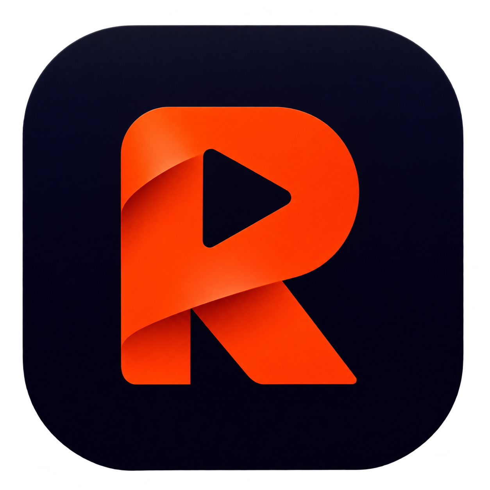

# RMP · Rust Media Player

Download the packaged app from [GitHub Releases](https://github.com/KMThegamer2022/RMP/releases).
A standalone native media player for Apple Silicon Macs. Open RMP.app, choose **Open Files…**, and select one or more media files. The Queue menu lists files in playback order. Choosing additional files appends them and starts the first new item. Use File → Open Network Stream for a direct media URL. Use Audio Track and Subtitles to select available embedded tracks during playback.

Space toggles playback. Command-O opens files, Command-U opens a stream, Command-[ and Command-] change queue items, and Control-Command-F toggles full screen.

## Build

On an Apple Silicon Mac, install a recent stable Rust toolchain, Xcode Command Line Tools and an arm64 VLC 3.0.x application at /Applications/VLC.app. Run `./build.sh` to create build/RMP.app. Set VLC_APP to use another VLC bundle, or pass an absolute output app path as the first argument. VLC is needed only when building. The resulting app carries its own libraries and plugins.

The Rust static library in src/lib.rs owns the queue, playback state and libVLC integration. ui.m is the native Objective-C AppKit interface. Hardware decoding is selected by libVLC when supported. This build is locally signed and has not been notarized by Apple.

## Verification

Tested locally with H.264 video and AAC audio in MKV, embedded SRT subtitles, FLAC audio, and fast-start MP4 over HTTP. Format and stream compatibility depend on codecs, encryption and server behavior.

## Windows x64

Windows 1.1 targets Windows 7 SP1 x64 and newer. Run RMP-Setup-x64.exe for a per-user installation with a Start menu shortcut and an entry in Programs and Features. For portable use, extract the entire Windows release ZIP to one folder and run RMP.exe. Use Open for a file, File → Open network stream for a URL, or drag files onto the window. Queue, Audio track and Subtitles are in the menu bar. F11 toggles fullscreen. The executable uses the same Rust playback core and a native Win32 interface.

GitHub Actions builds the x64 executable, bundles the pinned VideoLAN runtime, and exercises WAV playback on a Windows runner. A successful Windows release tag publishes the ZIP. See [.github/workflows/windows.yml](.github/workflows/windows.yml) for the toolchain and packaging steps.

The Windows interface uses Segoe UI and themed Win32 controls. On a Windows 7 Aero desktop, the frame extends into the player above the video. A solid frame is used when composition is unavailable or High Contrast is active. GitHub Actions tests portable playback, installation, installed playback, and uninstallation on Windows Server 2022. Visual and runtime testing on Windows 7 SP1 is pending.
